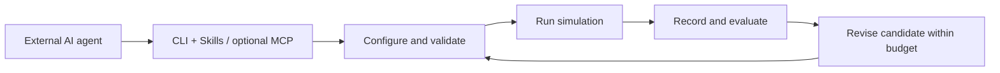

  

# OceanStudio: An Extensible Platform for AI Agent-Driven Experimentation in Underwater Robotics

  <strong>English</strong> | <a href="README.zh-CN.md">简体中文</a>

OceanStudio brings robot configuration, underwater environments, control experiments, and evaluation into a browser-based workspace. Researchers and external AI agents use the same platform to configure simulations, inspect results, and iterate on algorithms.

> **Project preview.** This repository currently contains the project introduction and branding. Source code and installation packages have not been released. Watch this repository for release updates.

## From experiment design to evaluated results

Underwater robotics experiments involve more than a controller. Vehicle parameters, sensor placement, currents, initial conditions, and evaluation criteria all affect the outcome. OceanStudio keeps these choices in an experiment configuration and connects them to recorded results.

The workspace follows four stages:

1. **Configure robots.** Select vehicles, assemble sensors, choose dynamics, and set each robot's parameters.
2. **Build the environment.** Select a world, set spawn poses, and configure water appearance and current disturbances.
3. **Define and run a task.** Set initial states, controllers, targets, and acceptance criteria with a shared 3D planning view.
4. **Evaluate the experiment.** Inspect trajectories, sensor observations, actuator histories, and task metrics through live views and replay.

## Capabilities in the development version

| Area | Capabilities |
| --- | --- |
| Robot configuration | Torpedo and hovering vehicles; single-robot experiments and fleets of up to four robots with independent configurations. |
| Sensor assembly | Vehicle-mounted cameras, imaging sonar, pose, depth, IMU, and DVL on supported native vehicles; configurable mounting and sampling. |
| Dynamics and control | Fossen-based vehicle dynamics, ideal rigid-body experiments, and reference six-degree-of-freedom models. PID, sliding-mode control, and linear MPC are selectable for supported native cruise tasks. |
| Environments | Compatible world-package import, spawn configuration, water appearance, and constant, sinusoidal, or combined sinusoidal currents. |
| Experiment tasks | Depth and heading control, cruise and S-shaped paths, figure-eight trajectories, approach-and-hold tasks, and supported fleet experiments. |
| Observation and evaluation | Recorded configurations and telemetry, multi-robot trajectories, RGB and sonar views, actuator histories, task metrics, and segmented replay. |
| Resource import | Custom AUV design packages containing a self-contained GLB model, mounting points, and parameters. Native UE execution requires a separate vehicle integration. |

Native simulation targets HoloOcean 2.4 and compatible Unreal Engine 5.3-based worlds. Reference models and native execution have different runtime contracts. Available combinations depend on the vehicle, task, and installed runtime assets.

## AI agents as experiment operators

OceanStudio provides a shared **CLI and project Skills**, with an optional **MCP** entry point. The integration is designed for external coding agents such as Codex, Claude Code, OpenCode, and DeepSeek Harness.

An agent can discover available capabilities, generate a candidate configuration, validate it, submit a trial, and evaluate its recorded results. Bounded experiment campaigns keep comparison conditions and trial budgets explicit while retaining unsuccessful trials.

For example, an experiment request could be:

> Configure one AUV and two ROVs. Compare PID, sliding-mode control, and MPC on supported S-shaped cruise tasks under the same current profile. Keep the environment and evaluation criteria fixed, then report the results of every trial.

This supports iterative experimentation. Automatic promotion of agent-written algorithms into the platform remains a development goal.

## Extend through explicit interfaces

OceanStudio separates experiment configuration from algorithm implementation. Extensions use namespaced Python modules and explicit registration, allowing new implementations to coexist with existing algorithms.

The extension interfaces cover sensors, kinematics, hydrodynamic loads, controllers, reference actuators, and tasks. Reviewed native axis-controller plugins can enter the supported native control pipeline. Other reference plugins require their corresponding reference runtime.

Append-only change checks and entry-point hashes support review and deployment. Strong filesystem isolation remains a separate deployment responsibility.

## Release direction

The next steps focus on preparing the source release, documenting deployment, and publishing runnable examples. Further work includes broader native vehicle and dynamics integration, evaluation extensions, and more complete validation of external-agent workflows.

Release timing, installation instructions, and licensing details will be announced in this repository. Engine binaries, world packages, and third-party assets are separate dependencies.

## Follow the project

Star or watch this repository for updates. Use [Issues](https://github.com/ZhangMacao/OceanStudio/issues) to suggest experiment workflows, discuss integration needs, or share research use cases.
