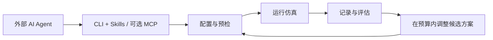

  

# OceanStudio: An Extensible Platform for AI Agent-Driven Experimentation in Underwater Robotics

  <a href="README.md">English</a> | <strong>简体中文</strong>

**面向水下机器人、支持 AI Agent 驱动实验的可扩展平台。**

OceanStudio 将机器人配置、水下环境、控制实验和结果评估组织在同一个浏览器工作台中。研究者与外部 AI Agent 可以通过统一的平台配置仿真、读取结果，并迭代算法。

> **项目预览阶段。** 本仓库目前仅包含项目介绍与品牌素材，尚未发布平台源码和安装包。欢迎关注仓库，获取后续发布动态。

## 从实验设计到结果评估

水下机器人实验的结果同时受载体参数、传感器安装位置、水流、初始条件和验收标准影响。OceanStudio 将这些选择保存为实验配置，并与运行记录关联，便于研究者检查每次实验采用的条件。

工作台围绕四个阶段组织：

1. **配置机器人。** 选择载体、装配传感器、选择动力学，并为每台机器人设置独立参数。
2. **设置环境。** 选择世界与出生位姿，配置水环境视觉效果和水流扰动。
3. **定义并运行任务。** 设置初始状态、控制算法、任务目标和验收标准，通过统一三维视图检查实验规划。
4. **评估实验。** 查看轨迹、传感器观测、执行器历史和任务指标，支持实时观测与历史回放。

## 开发版本已实现的能力

| 方向 | 当前能力 |
| --- | --- |
| 机器人配置 | Torpedo 与 Hovering 载体；支持单机器人，以及最多四台机器人独立配置的编队实验。 |
| 传感器装配 | 在受支持的原生载体上配置相机、成像声呐、位姿、深度、IMU 和 DVL；支持安装位与采样设置。 |
| 动力学与控制 | Fossen 载体动力学、理想刚体实验和参考六自由度模型；受支持的原生巡航任务可选择 PID、滑模和线性 MPC。 |
| 环境设置 | 兼容世界包导入、出生点设置、水环境视觉效果，以及固定方向、正弦和多正弦组合水流。 |
| 实验任务 | 定深与定向、定速与 S 型巡航、八字轨迹、进近保持，以及受支持的多机器人任务。 |
| 观测与评估 | 保存配置和遥测数据，查看多机器人轨迹、RGB 与声呐、执行器历史、任务指标，并按需分段回放。 |
| 资源导入 | 导入包含自包含 GLB、挂点和参数的自定义 AUV 设计包；进入原生 UE 运行仍需单独适配载体。 |

原生仿真面向 HoloOcean 2.4 与兼容的 Unreal Engine 5.3 世界。参考模型与原生运行采用不同的接口契约；具体可用组合取决于载体、任务和已安装的运行资产。

## 让 AI Agent 操作实验

OceanStudio 通过统一 **CLI 与项目 Skills** 提供实验能力，并保留可选的 **MCP** 入口。该接口面向 Codex、Claude Code、OpenCode、DeepSeek Harness 等外部编码智能体设计。

Agent 可以查询可用能力、生成候选配置、预检、提交实验，并读取原始记录进行评估。有界实验 Campaign 固定比较条件和试验预算，同时保留未成功的试验。

例如，可以向 Agent 提出以下实验需求：

> 配置一台 AUV 和两台 ROV。在相同水流条件下，对受支持的 S 型巡航任务比较 PID、滑模和 MPC。保持环境与验收标准一致，报告每次试验的结果。

平台以此支持多轮实验迭代；自动将 Agent 编写的算法晋升为平台默认实现，仍属于后续开发目标。

## 通过明确接口扩展

OceanStudio 将实验配置与算法实现分开。扩展以带命名空间的独立 Python 模块显式注册，使新实现与已有算法共存。

扩展接口覆盖传感器、运动学、水动力载荷、控制器、参考执行器和任务。经过审阅的原生分轴控制插件可以进入已有原生控制链；其他参考插件需要匹配的参考运行环境。

只新增文件检查和入口摘要为审阅、部署提供依据。强制文件写入隔离仍需由部署环境提供。

## 发布方向

下一阶段将准备源码发布、部署文档和可运行示例，并继续完善原生载体与动力学接入、评估扩展，以及外部 Agent 工作流验证。

发布时间、安装方法和许可安排将在本仓库公布。引擎二进制、世界包和第三方资产作为独立依赖管理。

## 关注项目

欢迎 Star 或 Watch 本仓库，获取后续动态。也可以通过 [Issues](https://github.com/ZhangMacao/OceanStudio/issues) 提出实验流程建议、集成需求或研究应用场景。
